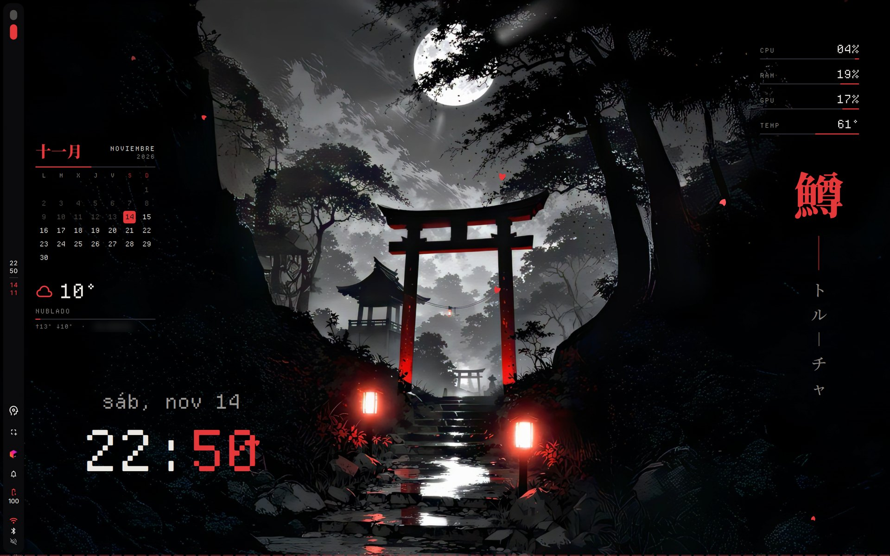
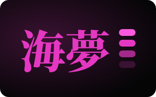
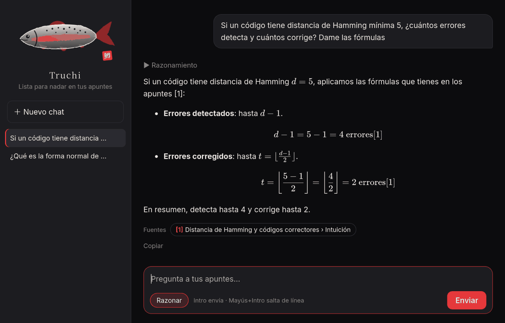
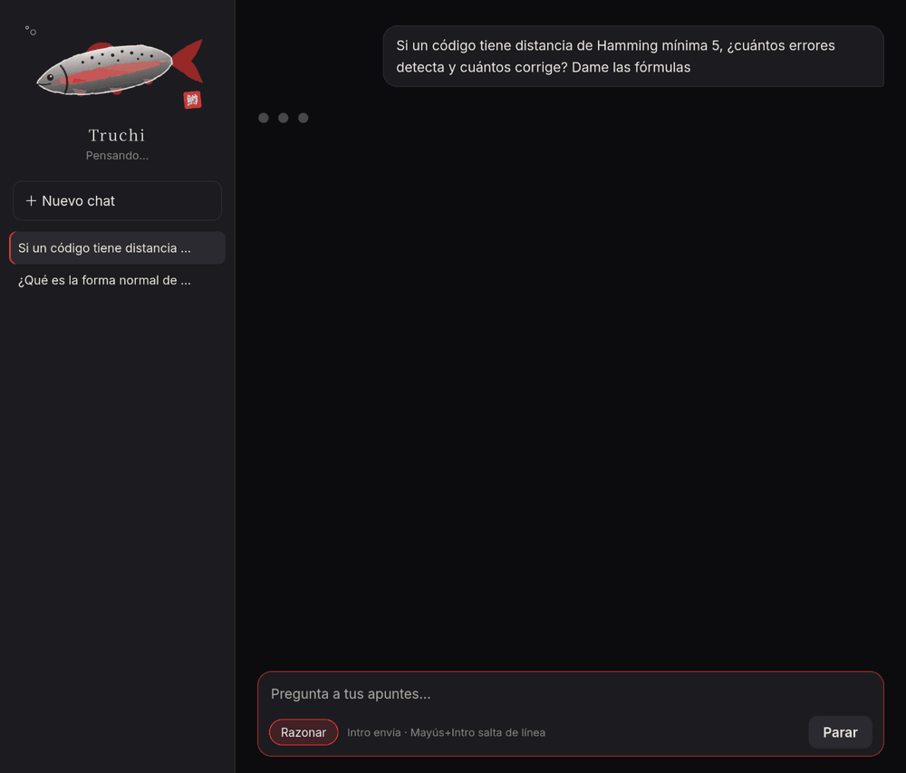
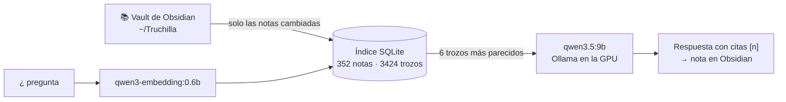
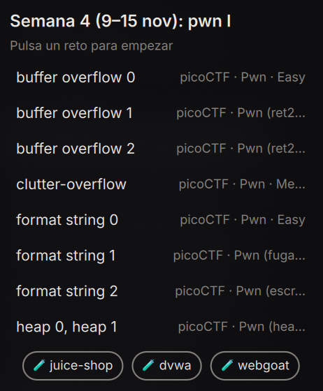
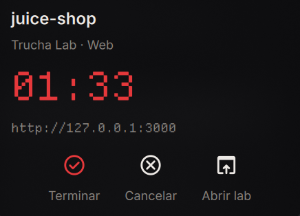

<div align="center">


<h1>Trucha OS! 鱒</h1>

**Mi Linux de autor: niri + DMS, tema Crimson Ink y una IA local que estudia conmigo.**

[](https://github.com/Gabriel-Vallejo/trucha-os/actions/workflows/ci.yml)
[](LICENSE)


-0c0c0e?logo=ollama&logoColor=white)



<sub>Crimson Ink: fondo animado, calendario con el mes en kanji, tiempo y reloj en fuente pixel, monitor del sistema, 鱒 en vertical y pétalos de sakura.</sub>

</div>

---

## ⚡ En un vistazo

| | |
|---|---|
| 🪟 **Ventanas** | [niri](https://github.com/YaLTeR/niri) 26.04: tiling con scroll infinito |
| 🧩 **Interfaz** | DMS 2.1 (paquete `dux-shell`, sobre Quickshell): barra lateral, dock, lanzador, notificaciones, bloqueo |
| 🎨 **Temas** | Crimson Ink · Miku Dark · Nino Dark · Marin Dark · Resident Evil · Ceniza · Kaitō · Sumi, con un atajo (⊞+Alt+T) |
| 🖼️ **Escritorio** | fondo animado (linux-wallpaperengine), reloj pixel, kanji vertical, cava, monitor, tiempo, calendario (十一月), letras, pétalos |
| 🧠 **Trucha Copilot** | IA local que responde con **mis apuntes** y cita la nota: app con chats y mascota, o `¿` en el lanzador |
| 🎮 **Fangames** | Launcher de fangames nativos (Pokémon Añil con mkxp-z, Pokémon Reloaded con OpenGMK), sin Wine; un `.toml` por juego |
| 🧪 **Trucha Lab** | Práctica de CTF con cronómetro en la barra, labs web en Docker y writeup al vault al acabar cada reto |
| 🛡️ **CTF** | **Competis** (⊞+Shift+Espacio), **Utilidades** con `=` (base64, hex, rot13, timestamps…) y OCR de una zona (⊞+Shift+X) |
| 💻 **Terminal** | kitty + starship + fastfetch con el torii |
| 🚀 **Arranque** | Plymouth: la trucha nada y se convierte en 鱒; tema de rEFInd |
| ✅ **Calidad** | 7 suites de tests (Python, node y bash) en cada push, en un contenedor de Arch |

---

## 🎨 Temas

Cada tema cambia **todo** a la vez: colores, fondo animado, kanji, fetch, login y partículas. Se eligen con ⊞+Alt+T (o `%` en el lanzador) y se aplican con `trucha-theme <id>`.

<table>
  <tr>
    <td align="center"><br><b>Miku Dark</b></td>
    <td align="center"><br><b>Nino Dark</b></td>
    <td align="center"><br><b>Marin Dark</b></td>
  </tr>
  <tr>
    <td align="center"><br><b>Resident Evil</b> · ceniza en vez de pétalos</td>
    <td align="center"><br><b>Ceniza</b> · Crimson Ink oscurecido</td>
    <td align="center"><b>Crimson Ink</b><br>el de la captura de arriba<br>(negro tinta y carmesí)</td>
  </tr>
  <tr>
    <td align="center"><br><b>Kaitō</b> · oro robado sobre negro de cómic</td>
    <td align="center"><br><b>Sumi</b> · el sobrio: jade apagado</td>
  </tr>
</table>

---

## 🧠 Trucha Copilot



Un asistente de estudio que responde **solo con mis apuntes de la carrera** (mi vault de Obsidian) y dice de qué nota sale cada dato. Funciona entero en el portátil: ni las notas ni las preguntas salen de él.

◆ **Chats con memoria**: puedo repreguntar («¿y su coste?») y se acuerda de lo anterior.<br>
◆ **Citas clicables**: cada fuente `[n] Nota › Sección` abre la nota en Obsidian.<br>
◆ **Fórmulas de verdad**: Markdown y LaTeX con KaTeX, como en los apuntes.<br>
◆ **Razonar** activado por defecto: más preciso, ~1 min. Sin él, de 3 a 19 s.<br>
◆ **Truchi**, la mascota sumi-e: flota, busca, echa burbujas al pensar y pone «?» si algo no está en los apuntes.

<br clear="right">

<table>
  <tr>
    <td width="60%"></td>
    <td width="40%"></td>
  </tr>
  <tr>
    <td align="center"><sub>Respuesta con fórmulas y la nota citada</sub></td>
    <td align="center"><sub>Truchi pensando</sub></td>
  </tr>
</table>

### Cómo se abre

| Dónde | Qué hace |
|---|---|
| 🧠 Botón de la barra | Clic: abre la app · clic derecho: el lanzador con `¿` |
| `¿pregunta` en el lanzador (⊞+Espacio) | Abre un chat nuevo con esa pregunta |
| Menú de aplicaciones | «Trucha Copilot» |
| Terminal | `trucha-copilot ask "pregunta"` · con `!` delante razona · `search` busca sin modelo · `index` rehace el índice |

### Cómo funciona



1. Troceo cada nota por títulos `##`/`###` (sin frontmatter) y cada trozo lleva delante «Nota › Sección».
2. En cada pregunta el índice se pone al día solo: reprocesa las notas nuevas o cambiadas y quita las borradas. Si Ollama actualiza el modelo de embeddings, lo rehace entero.
3. Busco los 6 trozos más parecidos (coseno, en Python puro) y se los paso al modelo, que debe responder solo con ellos y citarlos.

### Modelos (medidos en una RTX 5070 Laptop de 8 GB)

| Modelo | Sin razonar | Razonando | Velocidad | |
|---|---|---|---|---|
| **qwen3.5:9b** | 3–19 s | 51–105 s | 42 tok/s | ✅ elegido: cabe entero en la GPU (5,7 GB con 8k de contexto) |
| qwen3.5:35b-a3b | 11–50 s | 49–266 s | 21 tok/s | igual de preciso, 2–3× más lento |
| gpt-oss:20b | — | 6–77 s | 19 tok/s | 16 % en CPU, no mejora en nada |

Embeddings con `qwen3-embedding:0.6b`: índice completo en **69 s**, cada búsqueda en **0,3 s**. Sin razonar, el 9b llegó a leer al revés un fragmento sobre FNBC; razonando acierta y cita, por eso Razonar viene activado.

### Privacidad

- Ollama escucha solo en `127.0.0.1:11434`.
- La interfaz es HTML local en una ventana GTK + WebKitGTK, con una CSP que no deja cargar nada de fuera. KaTeX y marked van copiados en el repo.
- Lo que escribe el modelo se escapa: no puede inyectar HTML ni enlaces `javascript:`.
- Índice en `~/.local/state/trucha-os/copilot.db` y chats en `copilot-chats.db`, junto a él.

> [!TIP]
> Otro vault: `TRUCHA_COPILOT_VAULT=/ruta`. Otro modelo: `TRUCHA_COPILOT_MODEL=nombre` (descárgalo antes con `ollama pull`).

---

## 🎮 Fangames

`trucha-fangames` (o **Fangames** en el lanzador) es una biblioteca de fangames que corren **nativos** en Linux: nada de Wine.
Tiene tres pestañas:

- **Biblioteca**: portada, banner, descripción, características, información general (autor, versión, género, idioma, web…), última partida y tiempo jugado. Se maneja con teclado o mando (↑↓ e Intro/A).
- **＋ Añadir**: eliges un `.zip` o una carpeta, lo descomprime en tu biblioteca y detecta el motor solo. Si marcas *Que Claude lo integre*, se lo pasa a Claude Code (`claude -p`, con permisos acotados), que busca la información del juego, le hace portada y banner con sus propios gráficos y lo prueba hasta que arranca.
- **Ajustes**: carpeta de juegos, orden, minimizar al jugar, motores instalados y accesos en el lanzador.

| Motor | Para qué | Dónde va |
|---|---|---|
| `mkxp-z` | RPG Maker XP/VX/VX Ace y Pokémon Essentials (Añil) | `~/Juegos/fangames/_runtimes/mkxp-z/` (build Linux x86_64 de las Actions de mkxp-z) |
| `opengmk` | Game Maker 8 (Reloaded) | `~/Juegos/fangames/_runtimes/opengmk/gm8emulator` |
| `wine` | último recurso | el `wine` del sistema |

Cada juego es un manifiesto `.toml`, así que añadir otro a mano es escribir un archivo en `~/.config/trucha-os/fangames/<id>.toml`:

```toml
id = "mi-fangame"            # letras, números y guiones
nombre = "Mi Fangame"
motor = "mkxp-z"             # mkxp-z · opengmk · wine
carpeta = "mi-fangame"       # dentro de ~/Juegos/fangames (o ruta absoluta)
ejecutable = "Juego.exe"     # solo opengmk y wine
autor = "Quien sea"
version = "1.0"
descripcion = "Dos o tres frases."
genero = "RPG de Pokémon"
idioma = "Español"
region = "Kanto"
lanzamiento = "2024"
web = "https://…"
logo = "Graphics/Titles/logo.png"            # opcional, dentro de la carpeta del juego
color = "#3b6fe0"            # color de la ficha
estado = "jugable"           # jugable · beta · en pruebas
etiquetas = ["RPG Maker XP"]
caracteristicas = ["Nuzlocke", "Megas"]
```

Juegos de RPG Maker viejos (Essentials de la era Ruby 1.8, con llamadas a la API de Windows) llevan
`compat = ["win32", "ruby18"]`: el launcher añade a su `mkxp.json` los envoltorios de mkxp-z y los parches de
`~/.local/share/trucha-os/fangames/compat/` (guarda el original como `mkxp.json.original`). Al importar se detecta solo.

La portada y el banner van por convención en `~/Juegos/fangames/_arte/<id>/portada.png` y `banner.png`; `trucha-fangames-arte` los monta con un fondo, el logo y unos sprites del propio juego.
En la terminal: `trucha-fangames lista`, `jugar <id>`, `probar <id>` (lo arranca, saca captura y lo cierra), `importar <zip> [--claude]` y `accesos`.

## 🧪 Trucha Lab

Práctica de CTF con cronómetro. Cada reto acaba como writeup en el vault y como ✅ en mi plan de 8 semanas.

```console
$ trucha-lab plan
Semana 4 (9–15 nov): pwn I: 0/11 hechos
  ⬜ buffer overflow 0  ·  picoCTF · Pwn · Easy
  ⬜ buffer overflow 1  ·  picoCTF · Pwn (ret2win) · Medium
  …
$ trucha-lab start buffer overflow 1
🎯 buffer overflow 1 · picoCTF · Pwn (ret2win) · Medium (semana 4)
⏱  Cronómetro en marcha. Al acabar: trucha-lab done
$ trucha-lab done
✅ buffer overflow 1 en 37 min → 20_Contexto/Writeups de práctica/Writeup - buffer overflow 1.md
```

| Orden | Qué hace |
|---|---|
| `plan [--semana N]` | Retos pendientes de la semana actual del plan |
| `start <reto>` | Arranca el cronómetro con un reto del plan, un lab o uno libre |
| `status` | Reto en curso y tiempo |
| `done [--abrir]` | Para, crea el writeup con su ficha, cambia ⬜ por ✅ en la tabla del plan y lo apunta en el hub de writeups (`--abrir` lo abre en Obsidian aunque no haya terminal) |
| `cancel` | Para sin escribir nada |
| `labs` | Labs web en Docker: Juice Shop (`:3000`), DVWA (`:8081`) y WebGoat (`:8082`) |

- Los labs se publican solo en `127.0.0.1`: son vulnerables a propósito y no se ven desde la red.
- En el plan solo cambia la fila del reto, y se escribe de forma atómica.
- La plantilla del writeup recuerda que no se apuntan flags ni credenciales.
- Sesión en `~/.local/state/trucha-os/lab.json`. Otro vault: `TRUCHA_LAB_VAULT=/ruta`.
- Necesita el plan en `20_Contexto/Plan de práctica de 8 semanas - CTF.md` dentro del vault. Para `labs`, `install.sh` instala Docker, lo activa y te mete en el grupo `docker` (vale al volver a entrar). Con `--solo-config` hazlo tú:

  ```bash
  sudo systemctl enable --now docker && sudo usermod -aG docker "$USER"
  ```

**En la barra.** El cronómetro está siempre en la barra.

<table>
  <tr>
    <td width="50%"></td>
    <td width="50%"></td>
  </tr>
</table>

- **Sin reto:** el icono va en gris. El popout lista los retos pendientes de la semana del plan y los labs, y al pulsar uno arranca.
- **Con reto:** el icono pasa a carmesí con el tiempo (los minutos debajo en la barra vertical, `mm:ss` en la horizontal). El popout tiene tres botones:
  - **Terminar** hace `done --abrir`: escribe el writeup y lo abre en Obsidian.
  - **Cancelar** para sin escribir nada.
  - **Abrir lab** lleva al navegador.

---

## 🚀 Instalar

Funciona sobre **CachyOS / Arch** (recomendado: todo viene de repos y AUR) y **Ubuntu 24.04 / Pop!_OS** (niri y Quickshell se compilan).

```bash
git clone https://github.com/Gabriel-Vallejo/trucha-os.git ~/trucha-os
cd ~/trucha-os
./install.sh
```

Después cierra sesión y entra en **niri**.

| Modo | Qué instala |
|---|---|
| `./install.sh` | Todo: paquetes, fuentes, configuración, fondos, marca, Plymouth, rEFInd, tecla ⊞, Trucha Copilot (Ollama, ~7 GB de modelos e índice) y Docker para Trucha Lab |
| `./install.sh --live` | Todo menos lo que no persiste en un USB live (marca, Plymouth, rEFInd) y sin Ollama |
| `./install.sh --solo-config` | Solo la configuración, sin paquetes ni `sudo` |

<details>
<summary><b>Pasarse a CachyOS paso a paso</b></summary>

1. Instala CachyOS (edición **niri**, o cualquiera y el instalador pone niri).
2. Monta la partición de Windows si tus fondos de Wallpaper Engine están allí:
   `udisksctl mount -b /dev/nvmeXnYpZ`
3. `./install.sh`. Hace en este orden:
   1. Instala paquetes con pacman y paru.
   2. Descarga las fuentes.
   3. Copia tu configuración.
   4. Importa los fondos y regenera los recursos derivados.
   5. Aplica la marca y los temas de Plymouth y rEFInd, y configura la tecla ⊞.
   6. Activa Ollama, descarga los modelos e indexa `~/Truchilla` si existe.

</details>

<details>
<summary><b>USB live</b></summary>

**Opción fácil (recomendada):** Ventoy + la ISO oficial de CachyOS.
1. Graba [Ventoy](https://www.ventoy.net) en el USB y copia dentro la ISO de CachyOS.
2. Si quieres que los cambios se guarden, añade un fichero de persistencia de Ventoy.
3. Arranca el USB, conéctate a internet y ejecuta `./install.sh --live`.

**Opción ISO propia (experimental):** `./iso/build-iso.sh` (en CachyOS/Arch, con `archiso`).
Genera `iso/out/trucha-os-*.iso`, con los paquetes dentro y un usuario live `trucha`/`trucha` que entra directamente en niri.

</details>

---

## ⌨️ Atajos y lanzador

| Atajo | Acción |
|---|---|
| ⊞ (sola) · ⊞+Espacio | Lanzador |
| ⊞+Alt+T | Cambiar de tema |
| ⊞+Shift+Espacio | Competis (ciberseguridad y hackatones) |
| ⊞+Shift+X | OCR de una zona al portapapeles (local) |
| ⊞+Ctrl+D | Nuevo escritorio |
| ⊞+E | Archivos |
| ⊞+T · ⊞+Intro | Terminal |
| ⊞+Shift+/ | Todos los atajos |

En el lanzador, el primer carácter elige el modo:

| Escribe | Modo |
|---|---|
| `¿` | 🧠 Trucha Copilot: pregunta a tus apuntes |
| `=` | 🧮 Utilidades: calculadora y conversiones (se copia al elegir) |
| `@` | 🛡️ Competis: apps, herramientas y webs de CTF |
| `%` | 🎨 Temas |

<details>
<summary><b>Todo lo que hacen las Utilidades (<code>=</code>)</b></summary>

- vacío → selector de color y capturas (zona, ventana, pantalla);
- `2^10/3`, `sqrt(2)`, `5!`, `3,5*2` → calculadora (sin `eval`);
- `255`, `0xff`, `0b1010` → decimal/hex/binario/octal y carácter;
- `ts` o `ts 1700000000` → timestamp Unix ↔ fecha;
- `#e5383b` → rgb y hsl;
- texto libre → base64, hex, rot13 y url, y lo decodifica si puede;
- prefijos: `b64` `b64d` `hex` `unhex` `rot13` `url` `urld` `bin` `unbin` `up` `low` `rev` `len`.

</details>

---

## 🧩 Widgets

| En el escritorio | |
|---|---|
| 📅 Calendario | El mes en kanji, semana de lunes a domingo y hoy en carmesí |
| ☁️ Tiempo | Temperatura, estado y máx/mín del día en la fuente pixel |
| 📊 Sistema | CPU, RAM, GPU y temperatura, sin cajas |
| 鱒 Kanji | 鱒 (trucha) en vertical con su lectura en katakana |
| 🎵 Música y letras | Reproductor MPRIS y letra sincronizada línea a línea; solo se ven cuando suena algo |
| 🔊 Visualizador | Barras de audio (cava) en carmesí |
| 🌸 Pétalos | Caen despacio con el color del tema; no bloquean clics |
| 🌑 Oscurecer | Capa con viñeta para fondos claros en temas oscuros |

| En la barra | |
|---|---|
| 🧠 Trucha Copilot | Abre la app (clic) o el lanzador con `¿` (clic derecho) |
| 🎧 Voz de Discord | Quién está en la llamada y quién habla, con silenciar y ensordecer |
| ⏱️ Trucha Lab | Cronómetro del reto de CTF: sin reto, los pendientes de la semana para arrancar uno; con reto, terminar (writeup al vault), cancelar y abrir el lab |

### 🎧 Voz de Discord

El widget `truchaDiscord` aparece solo en un canal de voz: clic para ver quién habla y clic derecho para silenciar. Usa el RPC oficial de Discord, sin parchear el cliente.

1. En el [portal de desarrolladores](https://discord.com/developers/applications) crea una aplicación.
2. En **OAuth2**, añade la redirección `http://127.0.0.1` y copia el Client ID y el Client Secret.
3. Ejecuta `trucha-discord-voice setup` (guarda las claves con permisos 600, fuera del repo).
4. Ejecuta `systemctl --user start trucha-discord-voice` con Discord abierto y acepta la ventana que abre Discord.

Si algo falla: `journalctl --user -u trucha-discord-voice`.

---

## 🖼️ Fondos de Wallpaper Engine

**No están en el repo**, porque son de sus autores. `scripts/import-wallpapers.sh` los copia de **tu** Wallpaper Engine: Steam de Linux o la partición de Windows.

| Tema | ID del workshop |
|---|---|
| Crimson Ink (torii) | 3404531656 |
| Miku Dark | 2397088460 |
| Nino Dark | 2376540588 |
| Marin Dark | 3489782387 |
| Resident Evil (Leon · Requiem) | 3665954520 |
| Ceniza | usa el de Crimson Ink, oscurecido |
| Kaitō (Katana Girl with Hologram) | 3238423642 |
| Sumi (Black and White) | 3337507151 |

Lo que deriva de ellos lo regenera `scripts/gen-crimson-assets.py`: el login de Crimson, su miniatura, el fondo de rEFInd, el logo del fetch y la marca de agua de Plymouth (esta se guarda en el repo).

### Añadir un tema

1. Copia el fondo a `~/.local/share/wallpaperengine/wallpapers/<nombre>`.
2. Crea `~/.config/trucha-os/themes/<id>.json` con estos campos:

   | Campo | Para qué |
   |---|---|
   | `accent_hue` | Tono del acento |
   | `accent_sat` | Opcional: menos de 1 apaga el acento (Sumi usa 0.45) |
   | `kanji`, `kana` | El kanji vertical y su lectura |
   | `dim` | Oscurecer el fondo |
   | `positions` | Opcional: mover widgets si el personaje los tapa |
   | `petals` | Opcional: `false` apaga los pétalos |
   | `particles` | Opcional: `"ash"` cambia los pétalos por ceniza |
   | `wallpaper_properties` | Opcional: propiedades de la escena (p. ej. `{"clock": false}` apaga el reloj del fondo) |

3. Ejecuta `trucha-theme-assets <id>` (genera el logo, el login y la miniatura) y elige el tema con ⊞+Alt+T.

---

## 🔁 Mantener el repo al día

Cuando cambio algo en el sistema:

```bash
./scripts/export.sh && git add -A && git commit -m "chore: actualizar configuración"
```

- Las rutas `/home/<tú>` se guardan como `__HOME__` y el instalador las adapta al usuario de destino.
- Mi ubicación (tiempo y modo noche) y el historial del lanzador no se exportan: el repo es público. Tras instalar, pon tu ubicación en los ajustes de DMS.

### Tests

Se pasan en cada push con GitHub Actions, en un contenedor `archlinux:latest`.

| Suite | Qué prueba |
|---|---|
| `utils.test.mjs` | Calculadora y conversiones de las Utilidades |
| `discord_voice.test.py` | Puente de voz de Discord contra un RPC simulado |
| `copilot.test.py` | Troceado, índice incremental, búsqueda y citas contra un Ollama simulado |
| `copilot_app.test.py` | Chats, memoria, parar y errores de la app |
| `copilot_render.test.mjs` | Markdown y LaTeX seguros (sin HTML ni enlaces peligrosos) |
| `lab.test.py` | Plan, cronómetro, writeups y labs de Trucha Lab con un vault de juguete y `docker` falso |
| `ocr.test.sh` | OCR con `dms` y `wl-copy` falsos |

---

## 🗂️ Estructura

<details>
<summary><b>Ver el árbol</b></summary>

```
install.sh                       instalador (completo, --live, --solo-config)
packages/                        arch.txt · aur.txt · ubuntu.txt
dotfiles/                        el $HOME de Trucha OS! (niri, DMS, kitty, temas, widgets, scripts…)
  .config/dms/plugins/           widgets y modos del lanzador (truchaCopilot, truchaLab, truchaUtils, competis…)
  .local/bin/trucha-copilot      RAG local: índice, búsqueda y respuesta con Ollama
  .local/bin/trucha-copilot-app  la app de Trucha Copilot (GTK + WebKitGTK)
  .local/bin/trucha-lab          práctica de CTF: cronómetro, labs en Docker y writeups al vault
  .local/share/trucha-os/copilot interfaz HTML de la app, Truchi y KaTeX/marked
system/keyd.conf                 tecla ⊞ sola = lanzador
scripts/export.sh                sistema → repo
scripts/import-wallpapers.sh     Wallpaper Engine → ~/.local/share/wallpaperengine
scripts/gen-crimson-assets.py    recursos derivados del torii
scripts/system.sh                marca, Plymouth, rEFInd, keyd (root)
scripts/ubuntu-build.sh          compilaciones para Ubuntu/Pop
iso/build-iso.sh                 ISO live propia (archiso, experimental)
tests/                           tests de Python, node y bash (CI)
docs/img/                        capturas de este README
```

</details>

---

## 🧭 Personalizaciones alternativas

[**SekaiPop**](https://github.com/Blapples/SekaiPop): shell de Quickshell para **Hyprland**, inspirada en Project Sekai, con barra y dock configurables, dos pantallas de bloqueo y sistema de plugins.

No forma parte de Trucha OS! ni se instala con `install.sh`: necesita Hyprland 0.55 o superior y sustituye a niri + DMS, así que los temas y widgets de este repo no funcionan con ella. Su instalador tiene modo de prueba y guarda tu configuración de Hyprland en una copia (`./install.sh --restore` la recupera).

---

## 📜 Licencia

[MIT](LICENSE) © 2026 Gabriel Vallejo García.

Incluye [KaTeX](https://katex.org) 0.16.22 y [marked](https://marked.js.org) 12.0.2, ambos MIT, con sus licencias en `dotfiles/.local/share/trucha-os/copilot/vendor/`.

<div align="center">

**¿Dudas o ideas? Abre un [issue](https://github.com/Gabriel-Vallejo/trucha-os/issues).** 🐟

</div>
